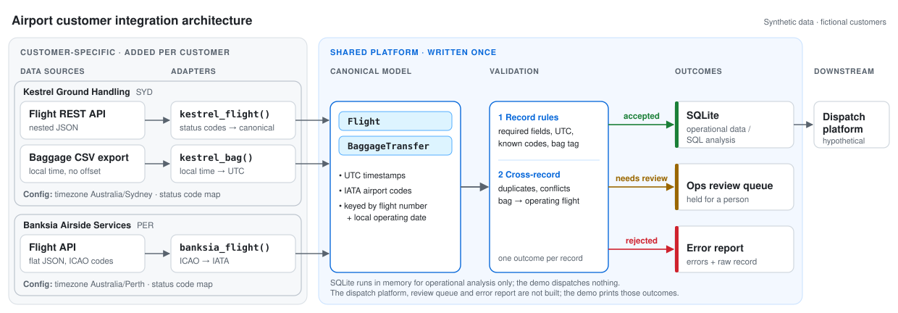

# Airport Customer Integration Architecture

A system-design case study: bringing a ground-handling customer's operational data, which arrives in incompatible formats, into one validated model that a dispatch platform can trust. The next customer is onboarded without changing the core.

Independent project. All customers, airlines and data are fictional.



## 1. Overview

A ground handler dispatches staff and equipment against flight schedules, transfer bags and ground-support equipment (GSE) availability. Each comes from a different customer system, and the systems disagree on identifiers (`XA0123` vs `XA 123`, ICAO `YSSY` vs IATA `SYD`), on time (UTC, offsets, local time with no offset) and on format (JSON, CSV).

The goal is one canonical model that dispatch can trust, with each new customer added through an adapter rather than a redesign.

## 2. Requirements

**Functional:** ingest flights (airline API), bag transfers (CSV export) and GSE availability (API). Normalise identifiers and timestamps. Give every record exactly one outcome, with a reason: **accepted**, **needs review** or **rejected**. Pass only accepted records to dispatch.

**Non-functional:**
- **Integrity before completeness:** never guess a timezone, code or missing value.
- **Isolation:** one bad record never blocks a batch, and customer formats never reach the core.
- **Traceability:** every record can be traced to its source.
- **Repeatability:** a new customer means a new adapter, mapping and tests.

## 3. Architecture

1. **Adapters:** one function per (customer, source), and the only code that knows a customer's field names, codes and time conventions. They parse, map identifiers and convert to UTC.
2. **Canonical model:** `Flight` and `BaggageTransfer`, with UTC timestamps and IATA codes.
   - `flight_key` is carrier + number + **local operating date**. Flight numbers repeat daily, and a flight leaving Sydney at 07:30 on 23 October is the 23 October flight, although in UTC it departs on the 22nd. Using the UTC date would make bags and flights silently fail to match.
   - The pipeline, not the adapter, stamps provenance (customer, source reference) on every record.
3. **Validation:** shared across customers, in two stages.
   - *Record rules:* required fields, UTC timestamps, known airports, valid status, 10-digit bag tag.
   - *Cross-source check:* a bag's outbound flight must exist and must not be cancelled.
4. **Outcomes:**
   - *Accepted* records go to dispatch.
   - *Rejected* records are kept with their errors, raw payload and source reference.
   - *Needs review* means well-formed but conflicting with other data.

**Records needing review.** The prototype prints them with a reason, outside the accepted set. In production they would go to an operations queue. Review is not "ignored": a bag heading for a cancelled flight still has to be rebooked. Items are re-checked when new data arrives, escalated near departure, and resolved by a person, with every decision logged.

## 4. Key Design Decisions

1. **Adapters are plain functions in a registry.** A declarative mapping config breaks on composite identifiers and local-time conversion. A class hierarchy adds structure, not capability. *Trade-off:* each customer needs some code, but it is short and tested.
2. **The platform owns the canonical model.** Passing customer fields through is faster at first but couples dispatch to every customer's format. *Trade-off:* changes to the model need versioning.
3. **Validation runs after normalisation, and is written once.** Adapters answer "can I parse this?". Validation answers "is this safe to use?". It doesn't trust adapters: a test shows it catches one that skips UTC conversion.
4. **Reject rather than guess.** Unmapped status codes, timestamps with no offset, and local times skipped or repeated by a daylight-saving change are rejected. *Trade-off:* more rejections early on, but mapping gaps surface during validation rather than in live operations.
5. **Each record is processed in isolation.** *Trade-off:* a truncated CSV could load partially, so production also needs file-level checks.

## 5. Customer Onboarding

| Stage | Activities |
|---|---|
| **Discover** | Get sample data. Document identifier and time conventions, and which source is authoritative for each field. |
| **Design** | Review a mapping spec with the customer's operations team. Write the adapter and config. |
| **Validate** | Write tests from real samples. Run in shadow mode alongside the current process, and review reconciliation reports with operations. |
| **Deploy** | Roll out in stages: read-only → advisory → operational, with a switch per customer. Rollback disables the feed. |

Here, onboarding Banksia took one adapter function, a status-code map, one entry each in `CUSTOMERS` and `ADAPTERS`, and tests. The model, validation and pipeline did not change.

## 6. Proof of Concept

`integration.py` (standard library only) implements two customers and three source formats (nested JSON, CSV with local time, flat JSON with ICAO codes), identifier normalisation, daylight-saving-safe timezone conversion, both validation stages and all three outcomes.

```bash
python3 integration.py        # Python 3.9+ (zoneinfo)
python3 -m unittest -v
```

The 15 sample records give **7 accepted, 2 needs review, 6 rejected**. For example:

| Record | Outcome |
|---|---|
| `XA0123` from Kestrel (UTC) and Banksia (ICAO, +11:00) | Identical canonical `Flight` |
| Bag onto cancelled `XB77` | Needs review |
| Unmapped status code `HLD` | Rejected, not guessed |
| Bag scanned at 02:30 on 4 Oct 2026, during the hour Sydney's clocks skip | Rejected |

## 7. Production Considerations

None of the following is implemented.

- **Source failures:** timeouts, retries with backoff, and a circuit breaker per source. Store raw payloads so they can be replayed after an adapter fix.
- **Duplicates and ordering:** an idempotency key of (source, record ID, update time). Apply an update only if it is newer than the stored state. Keep late events for audit.
- **Conflicts:** decide per field which source wins (the airline for flight status, the baggage system for bag routing). Send disagreements that matter operationally to review.
- **Staleness and outages:** set a freshness limit per source. Show stale data with its age, never as current. Agree a manual fallback with the customer. Dispatching a tug that is actually unavailable is worse than a slower decision.
- **Checks and monitoring:** expected CSV header, model versioning, and alerts on rejection rate, review-item age and data freshness.

## 8. Limitations

- Batch, in-memory, single run: no persistence and no delivery. Results are printed.
- No deduplication. The cross-source check uses whichever duplicate flight arrived last.
- `source_ref` is positional. Production should carry the source system's record ID.
- Only outbound flights are cross-checked, because the sample flight feed contains departures only.
- GSE is design only. Reference data covers three airports. Airline designators are placeholders.
